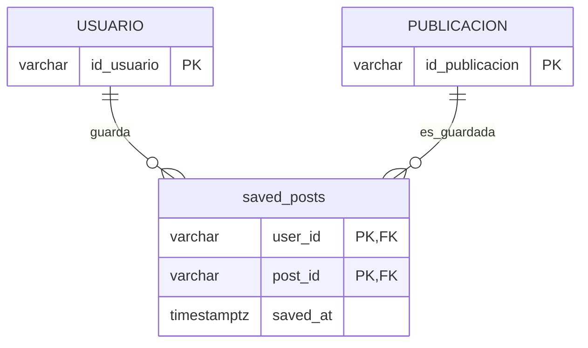

# Extensión del MER: publicaciones guardadas

Este fragmento complementa el MER entregado (`Diagrama_MER.jpg`) con la
relación de guardados. La clave primaria compuesta evita duplicar el guardado
de una misma publicación por usuario.

