# Arquitectura del ML Service

Este esquema resume el límite de responsabilidad y las llamadas del servicio
de recomendaciones. El backend conserva la lógica de negocio y prepara los
datos; `ml-service` calcula y devuelve el orden y las puntuaciones.

```mermaid
flowchart LR
    client[Flutter / consumidor]
    gateway[API Gateway]
    recommendation[recommendation-service]
    ml[ml-service<br/>FastAPI · Python]
    pipeline[UserPreferencesPipeline]
    model[RecommendationModel<br/>similitud coseno]
    response[Recomendaciones<br/>score + motivo]

    client -->|HTTP/REST| gateway
    gateway -->|ruta de recomendaciones| recommendation
    recommendation -->|HTTP JSON: perfil + candidatos/catálogo| ml
    ml --> pipeline
    pipeline -->|vectores de características| model
    model --> response
    response -->|HTTP JSON| recommendation
    recommendation -->|respuesta según reglas de negocio| gateway
    gateway --> client
```



## Flujo de datos

1. El consumidor solicita una recomendación al backend.
2. `recommendation-service` prepara el perfil del usuario y filtra/proporciona
   los candidatos o el catálogo que corresponde.
3. El backend invoca `ml-service` mediante HTTP con JSON. Los endpoints de
   recomendación no consultan por su cuenta usuarios, catálogo ni base de datos.
4. El pipeline normaliza las preferencias y las convierte en características.
5. El modelo calcula similitud, ordena los candidatos y produce puntuaciones y
   motivos legibles.
6. La respuesta se devuelve al backend, que conserva la responsabilidad sobre
   reglas del producto y la respuesta final al consumidor.

## Endpoints internos del servicio

```text
GET  /health
GET  /ready
POST /predict
POST /recommendations/friends
POST /recommendations/music
```

`/predict` es un endpoint de demostración que genera sugerencias de ejemplo.
Los flujos de similitud con perfiles y catálogo corresponden a
`/recommendations/friends` y `/recommendations/music`, respectivamente. Para
contratos y ejemplos completos, consulta
[`ml-service/README.md`](../ml-service/README.md) y el
[esquema OpenAPI](./ml-service-openapi.json).

## Ejecución local

Para desarrollo o pruebas, un consumidor puede llamar directamente a la API
local en `http://localhost:8001`; en Docker Compose el puerto publicado es el
mismo. En el despliegue integrado, la comunicación backend-a-ML ocurre dentro
de la red configurada para los servicios.
